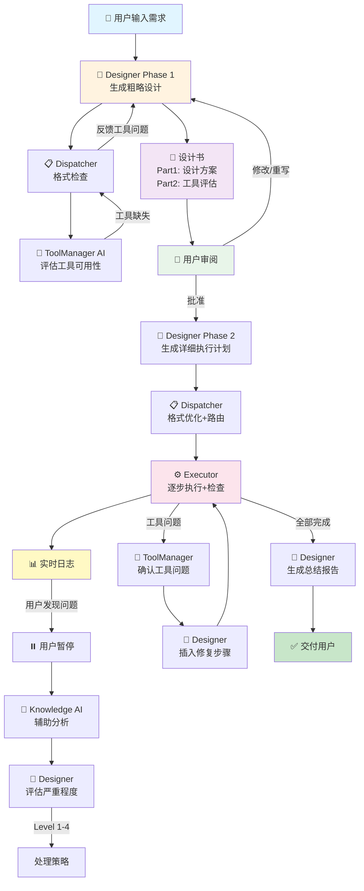

# EAS 2.0 架构设计文档

> **重新设计的AI任务编排系统**
> 
> 核心理念：用户可控 + 职责分离 + 工具复用 + Context管理
>
> 文档创建日期：2026-08-21

---

## 🎯 核心理念

### **设计目标**

1. **用户可控** - 不是AI全自动，而是用户随时可以介入
2. **职责分离** - 每个AI只负责自己的事，避免Context爆炸
3. **工具复用** - 强调工具库、技能库的复用性
4. **透明可见** - 每一步都可见，用户能理解和干预

### **与现有EAS的核心差异**

| 维度 | 现有EAS | 新架构 |
|------|---------|--------|
| **用户介入** | 自动执行，无法干预 | 设计书审阅 + 执行中暂停 |
| **角色职责** | Waiter只生成Plan | Designer全流程参与 |
| **质量检查** | Inspector最后统一检查 | Executor边执行边检查 |
| **工具管理** | Registry纯程序 | ToolManager AI智能评估 |
| **计划调整** | Plan静态，无法修改 | 动态计划，可插入步骤 |
| **Context管理** | 类似Hermes大Agent | 职责分离，Context独立 |

---

## 🏗️ 整体架构



---

## 👥 核心角色

### 1. **Designer（设计师）** 🎨

**职责：全流程设计与监督**

#### Phase 1: 生成设计书
**输入：**
- 用户需求描述

**处理：**
- 理解用户意图
- 设计初步架构
- 列出需要的工具
- 评估实现难度

**输出：设计书**
```
Part 1: 设计方案
  - 架构设计
  - 实现难度评估
  - 不包含具体工期（只说架构和难度）

Part 2: 工具评估（由ToolManager反馈后补充）
  - 工具完整性
  - 工具质量等级
  - 缺失工具的影响
```

#### Phase 2: 生成执行计划
**输入：**
- 用户批准的设计书

**输出：执行计划**
```json
{
  "plan_id": "plan-001",
  "segments": [
    {
      "segment_id": "seg-1",
      "steps": [
        {
          "step_id": "step-1",
          "order": 1,
          "description": "读取配置文件",
          "tool": "read_file",
          "inputs": {"path": "config.yaml"},
          "check_criteria": "文件内容为有效YAML格式",
          "outputs": ["config_data"]
        }
      ]
    }
  ],
  "implementation_list": [
    "步骤1: 读取配置",
    "步骤2: 处理数据",
    "步骤3: 写入结果"
  ]
}
```

#### 评估问题严重程度
当用户暂停并报告问题时：
```
Level 1 (最严重): 删除重做
  - 整个方向错了
  - 操作: 停止所有，用户决定保留/删除文件

Level 2: 重新设计
  - 某个设计有问题
  - 操作: 取消当前计划，Designer重新设计

Level 3: 修改部分计划
  - 需要补充步骤（如缺工具）
  - 操作: 动态插入新步骤

Level 4 (最轻): 停止，用户自己做
  - AI改起来太麻烦
  - 操作: 不继续了，用户手动完成
```

#### 生成总结报告
**在执行完成后：**
- 汇总执行结果
- 不是"检查"，只是总结
- 生成最终报告交付用户

**使用的模型：**
- 推荐：Claude Opus 5（推理能力强）
- 备选：GPT-4 Turbo

---

### 2. **ToolManager AI（工具管理员）** 🔧

**职责：智能工具管理**

#### 工具入库评估
当新工具加入时：
1. **测试工具能力**
   - 运行工具的测试用例
   - 评估工具的实际能力

2. **生成能力标准文档**
```json
{
  "tool_id": "image_generator",
  "version": "1.0",
  "capabilities": {
    "instructions": [
      "generate_image",
      "edit_image",
      "resize_image"
    ],
    "input_format": {
      "prompt": "string",
      "size": "string (e.g., '1024x1024')",
      "style": "string (optional)"
    },
    "output_format": {
      "image_url": "string",
      "format": "string (png/jpg)"
    },
    "quality_level": "high",
    "limitations": [
      "不支持透明背景",
      "最大分辨率2048x2048"
    ]
  },
  "file_location": "/tools/image_generator",
  "index": {
    "main": "main.py",
    "config": "config.yaml",
    "tests": "tests/"
  }
}
```

#### 工具可用性检查
Designer请求检查工具时：
1. 查询工具库
2. 返回工具可用性和能力描述
3. 如果工具缺失，返回缺失信息

#### 工具问题确认
Executor报告工具问题时：
1. 重新测试工具
2. 确认问题是否存在
3. 反馈给Designer

**使用的模型：**
- 推荐：Claude Sonnet 4（平衡性能和成本）
- 备选：GPT-4o mini

---

### 3. **Dispatcher（调度器）** 📋

**职责：格式检查 + 路由 + 日志**

**注意：这是纯程序，不使用AI**

#### 功能
1. **格式检查**
   - 检查Plan的格式是否正确
   - 检查step之间的依赖关系
   - 优化格式

2. **路由**
   - 将Designer的请求路由到ToolManager
   - 将执行请求路由到Executor
   - 管理消息传递

3. **日志记录**
   - 记录每一步的执行情况
   - 实时更新日志
   - 供用户和Knowledge AI查询

#### 为什么不用AI？
- 格式检查是机械工作
- 专业Designer给出的格式通常正确
- 如果用AI，幻觉会影响整个系统
- 纯程序更快、更稳定

**实现语言：Rust**

---

### 4. **Executor（执行器）** ⚙️

**职责：执行工具 + 自我检查**

#### 执行流程
```
1. 接收一个Step
2. 准备输入数据
3. 调用工具
4. 接收输出
5. 根据check_criteria检查结果
6. 如果检查通过，标记完成
7. 如果检查失败：
   - 记录错误
   - 报告给Dispatcher
   - 等待处理（用户介入 or Designer决策）
```

#### 自我检查机制
- **不需要独立的Inspector**
- Executor执行完后，根据Designer提供的check_criteria自己检查
- 检查方式：运行测试，验证功能

#### 工具实例管理
- 工具复制：简单的Ctrl+C, Ctrl+V
- 每次调用创建新实例
- 用完删除

**使用的模型：**
- 可选：Claude Haiku 4.5（如果需要AI辅助）
- 或纯程序执行

---

### 5. **Knowledge AI（知识助手）** 🧠

**职责：独立查询助手**

#### 特点
- **独立**：不影响主流程
- **只读**：只查询，不修改
- **无Context**：一次性对话，不维护长期Context

#### 能力
1. **查询日志**
   - 查看项目当前状态
   - 查看历史执行记录
   - 帮助用户理解发生了什么

2. **查询知识库**
   - 查询工具信息
   - 查询历史项目
   - 辅助用户决策

#### 使用场景
- 用户审阅设计书时，咨询某个设计是否合理
- 用户发现执行问题时，咨询问题是否严重
- 用户想了解某个工具的能力

**使用的模型：**
- 推荐：Claude Haiku 4.5（快速、便宜）
- 备选：GPT-4o mini

---

## 📊 核心数据结构

### 设计书（Design Document）

```json
{
  "design_id": "design-001",
  "user_request": "创建一个网站，包含前端、后端和数据库",
  "timestamp": "2026-08-21T10:00:00Z",
  
  "part1_design": {
    "architecture": {
      "components": [
        "前端（React）",
        "后端（FastAPI）",
        "数据库（PostgreSQL）"
      ],
      "interactions": [
        "前端通过REST API调用后端",
        "后端读写数据库"
      ]
    },
    "difficulty": {
      "overall": "中等",
      "breakdown": {
        "前端": "简单（使用模板）",
        "后端": "中等（需要设计API）",
        "数据库": "简单（标准设计）"
      }
    }
  },
  
  "part2_tool_assessment": {
    "required_tools": [
      {
        "tool_id": "react_template_generator",
        "availability": "available",
        "quality": "high",
        "limitations": []
      },
      {
        "tool_id": "fastapi_generator",
        "availability": "available",
        "quality": "medium",
        "limitations": ["缺少认证模块"]
      },
      {
        "tool_id": "postgres_setup",
        "availability": "missing",
        "impact": "需要手动配置或创建新工具"
      }
    ],
    "overall_tool_completeness": "80%",
    "risks": [
      "数据库配置工具缺失",
      "后端认证模块需要补充"
    ]
  },
  
  "user_approval": null,
  "user_comments": []
}
```

### 执行计划（Execution Plan）

```json
{
  "plan_id": "plan-001",
  "design_id": "design-001",
  "created_at": "2026-08-21T10:30:00Z",
  "status": "executing",
  
  "segments": [
    {
      "segment_id": "seg-1",
      "description": "准备环境",
      "steps": [
        {
          "step_id": "step-1-1",
          "order": 1,
          "description": "创建项目目录",
          "tool": "create_directory",
          "inputs": {
            "path": "./my-website"
          },
          "check_criteria": "目录存在且可写",
          "outputs": ["project_dir"],
          "status": "completed",
          "executed_at": "2026-08-21T10:35:00Z"
        },
        {
          "step_id": "step-1-2",
          "order": 2,
          "description": "安装依赖",
          "tool": "npm_install",
          "inputs": {
            "directory": "$project_dir",
            "packages": ["react", "react-dom"]
          },
          "check_criteria": "node_modules存在且package.json更新",
          "outputs": ["dependencies_installed"],
          "status": "pending"
        }
      ]
    },
    {
      "segment_id": "seg-2",
      "description": "实现功能",
      "steps": [
        {
          "step_id": "step-2-1",
          "order": 3,
          "description": "生成前端模板",
          "tool": "react_template_generator",
          "inputs": {
            "template": "dashboard",
            "output_dir": "$project_dir/frontend"
          },
          "check_criteria": "前端代码可以编译且无语法错误",
          "outputs": ["frontend_code"],
          "status": "pending"
        }
      ]
    }
  ],
  
  "implementation_list": [
    "1. 创建项目目录结构",
    "2. 安装前端依赖（React）",
    "3. 生成前端模板",
    "4. 创建后端API（FastAPI）",
    "5. 配置数据库连接",
    "6. 测试前后端集成"
  ],
  
  "dynamic_insertions": []
}
```

### 工具Schema（Tool Schema）

```json
{
  "tool_id": "image_generator",
  "version": "1.0",
  "name": "图片生成器",
  "description": "使用AI生成图片",
  
  "capabilities": {
    "instructions": [
      {
        "name": "generate_image",
        "description": "生成新图片",
        "parameters": {
          "prompt": "string",
          "size": "string",
          "style": "string?"
        }
      },
      {
        "name": "edit_image",
        "description": "编辑现有图片",
        "parameters": {
          "image_path": "string",
          "edit_prompt": "string"
        }
      }
    ],
    
    "input_format": {
      "type": "object",
      "properties": {
        "instruction": {
          "type": "string",
          "enum": ["generate_image", "edit_image"]
        },
        "parameters": {
          "type": "object"
        }
      },
      "required": ["instruction", "parameters"]
    },
    
    "output_format": {
      "type": "object",
      "properties": {
        "success": {"type": "boolean"},
        "image_url": {"type": "string"},
        "format": {"type": "string"},
        "metadata": {"type": "object"}
      }
    },
    
    "quality_level": "high",
    "performance": {
      "avg_execution_time": "5s",
      "success_rate": "95%"
    },
    
    "limitations": [
      "不支持透明背景",
      "最大分辨率2048x2048",
      "每分钟最多10次调用"
    ]
  },
  
  "file_location": "/tools/image_generator",
  "index": {
    "main": "main.py",
    "config": "config.yaml",
    "tests": "tests/test_generator.py",
    "docs": "README.md"
  },
  
  "license": {
    "type": "concurrent",
    "max_instances": 5,
    "copy_strategy": "clone_and_delete"
  },
  
  "dependencies": [
    "openai==1.0.0",
    "pillow==10.0.0"
  ],
  
  "test_results": {
    "last_test_date": "2026-08-20",
    "passed": true,
    "test_cases": 15,
    "passed_cases": 15
  }
}
```

---

## 🔄 核心流程

### 1. 设计阶段

```
用户输入需求
    ↓
Designer Phase 1 生成粗略设计
    ↓
Dispatcher 格式检查
    ↓
ToolManager 评估工具可用性
    ↓
    如果工具缺失：
        ToolManager → Dispatcher → Designer
        Designer 补充设计书（说明工具缺失的影响）
    ↓
Designer 完成设计书（Part1 + Part2）
    ↓
用户审阅设计书
    ├─ 修改：用户直接编辑设计书文本
    ├─ 重写：用户写新需求，Designer重新设计
    └─ 批准：进入Phase 2
```

### 2. 计划生成

```
用户批准设计书
    ↓
Designer Phase 2 生成详细执行计划
    包含：
    - 每个步骤的具体操作
    - 工具调用
    - 检查标准
    - 实施列表
    ↓
Dispatcher 格式检查和优化
    ↓
执行计划存储到数据库
```

### 3. 执行阶段

```
Dispatcher 按顺序取步骤
    ↓
Executor 执行步骤
    1. 准备输入
    2. 调用工具（创建工具实例）
    3. 接收输出
    4. 根据check_criteria自我检查
    5. 删除工具实例
    ↓
    如果检查通过：
        记录日志 → 下一步
    ↓
    如果检查失败：
        记录错误 → 报告给Dispatcher
        ↓
        等待用户介入（可设置超时时间）
        ↓
        如果用户不处理：
            Dispatcher → Designer
            Designer 评估问题严重程度
            Designer 决定处理策略
    ↓
    如果发现工具问题：
        Executor → Dispatcher → ToolManager
        ToolManager 确认工具问题
        ToolManager → Dispatcher → Designer
        Designer 插入修复步骤（动态计划）
    ↓
所有步骤完成
    ↓
Designer 生成总结报告
    ↓
交付用户
```

### 4. 用户介入流程

```
用户在执行日志中发现问题
    ↓
用户点击"暂停"
    ↓
（可选）用户咨询Knowledge AI
    Knowledge AI 查询日志和知识库
    Knowledge AI 给出建议
    ↓
用户决定处理方式：
    ├─ 继续执行（问题不严重）
    ├─ 咨询Designer（让AI评估）
    │   ↓
    │   Designer 评估问题严重程度
    │   Designer 给出Level 1-4建议
    │   ↓
    │   用户选择：
    │       Level 1: 删除重做
    │       Level 2: 重新设计
    │       Level 3: 修改部分计划
    │       Level 4: 停止，用户自己做
    └─ 直接修改计划（用户自己编辑）
```

---

## 🔧 技术栈

### **混合架构：Rust + Python**

```
┌─────────────────────────────────────────┐
│          Rust 层（快速+稳定）             │
├─────────────────────────────────────────┤
│  • GUI (egui)                           │
│  • Dispatcher (格式检查+路由)            │
│  • 日志系统                              │
│  • 工具实例管理                          │
│  • HTTP/gRPC 服务器                     │
└─────────────────────────────────────────┘
                    ↕ HTTP/gRPC
┌─────────────────────────────────────────┐
│         Python 层（AI调用）              │
├─────────────────────────────────────────┤
│  • Designer AI                          │
│  • ToolManager AI                       │
│  • Knowledge AI                         │
│  • Executor AI (可选)                   │
│  • LLM Client (OpenAI/Anthropic SDK)    │
└─────────────────────────────────────────┘
                    ↕
┌─────────────────────────────────────────┐
│            共享层                        │
├─────────────────────────────────────────┤
│  • KB 存储 (SQLite/PostgreSQL)          │
│  • 日志数据库                            │
│  • 工具库                                │
└─────────────────────────────────────────┘
```

### 职责分工

| 层 | 语言 | 模块 | 理由 |
|---|------|------|------|
| **前端** | Rust | GUI (egui) | 性能好，用户已选择 |
| **调度** | Rust | Dispatcher | 纯逻辑，不需要AI，Rust更快 |
| **日志** | Rust | 日志系统 | 高并发写入，Rust性能好 |
| **AI服务** | Python | Designer, ToolManager, Knowledge AI | AI库最成熟 |
| **存储** | SQL | SQLite/PostgreSQL | 通用，两边都能访问 |

### 通信方式

**Rust ↔ Python：**
- HTTP REST API（简单，推荐）
- 或 gRPC（更快，但复杂）

**数据格式：**
- JSON（REST API）
- Protobuf（gRPC）

---

## 🗄️ 数据库设计

### 设计书表（designs）

```sql
CREATE TABLE designs (
    design_id TEXT PRIMARY KEY,
    user_request TEXT NOT NULL,
    created_at TIMESTAMP DEFAULT CURRENT_TIMESTAMP,
    part1_design JSON NOT NULL,
    part2_tool_assessment JSON,
    user_approval BOOLEAN DEFAULT NULL,
    user_comments TEXT
);
```

### 执行计划表（plans）

```sql
CREATE TABLE plans (
    plan_id TEXT PRIMARY KEY,
    design_id TEXT NOT NULL,
    created_at TIMESTAMP DEFAULT CURRENT_TIMESTAMP,
    status TEXT NOT NULL, -- pending, executing, completed, failed
    segments JSON NOT NULL,
    implementation_list JSON NOT NULL,
    FOREIGN KEY (design_id) REFERENCES designs(design_id)
);
```

### 步骤表（steps）

**支持动态插入：**

```sql
CREATE TABLE steps (
    step_id TEXT PRIMARY KEY,
    plan_id TEXT NOT NULL,
    segment_id TEXT NOT NULL,
    order_num INTEGER NOT NULL,
    description TEXT NOT NULL,
    tool TEXT NOT NULL,
    inputs JSON NOT NULL,
    check_criteria TEXT NOT NULL,
    outputs JSON NOT NULL,
    status TEXT NOT NULL, -- pending, executing, completed, failed
    executed_at TIMESTAMP,
    error_message TEXT,
    FOREIGN KEY (plan_id) REFERENCES plans(plan_id)
);

CREATE INDEX idx_steps_plan_order ON steps(plan_id, order_num);
```

**动态插入步骤：**
```sql
-- 在step 5和6之间插入新步骤
-- 1. 将6及之后的步骤order_num +1
UPDATE steps 
SET order_num = order_num + 1 
WHERE plan_id = 'plan-001' AND order_num >= 6;

-- 2. 插入新步骤，order_num = 6
INSERT INTO steps (step_id, plan_id, order_num, ...) 
VALUES ('step-new', 'plan-001', 6, ...);
```

### 工具表（tools）

```sql
CREATE TABLE tools (
    tool_id TEXT NOT NULL,
    version TEXT NOT NULL,
    name TEXT NOT NULL,
    description TEXT,
    capabilities JSON NOT NULL,
    file_location TEXT NOT NULL,
    quality_level TEXT,
    test_results JSON,
    status TEXT DEFAULT 'active', -- active, trashed
    created_at TIMESTAMP DEFAULT CURRENT_TIMESTAMP,
    updated_at TIMESTAMP DEFAULT CURRENT_TIMESTAMP,
    PRIMARY KEY (tool_id, version)
);
```

### 日志表（logs）

```sql
CREATE TABLE logs (
    log_id INTEGER PRIMARY KEY AUTOINCREMENT,
    timestamp TIMESTAMP DEFAULT CURRENT_TIMESTAMP,
    plan_id TEXT,
    step_id TEXT,
    level TEXT NOT NULL, -- info, warning, error
    agent TEXT NOT NULL, -- designer, executor, dispatcher, etc.
    message TEXT NOT NULL,
    metadata JSON
);

CREATE INDEX idx_logs_plan ON logs(plan_id, timestamp);
CREATE INDEX idx_logs_step ON logs(step_id);
```

---

## ⚙️ 模型管理系统

### **核心功能**

多个Agent使用不同的模型，需要专业的模型管理：

1. **模型注册**
2. **模型测试**
3. **模型评级**
4. **模型回收站**

### 模型配置

```yaml
models:
  designer:
    primary:
      provider: anthropic
      model: claude-opus-5
      temperature: 0.7
    fallback:
      provider: openai
      model: gpt-4-turbo
      temperature: 0.7
  
  toolmanager:
    primary:
      provider: anthropic
      model: claude-sonnet-4
      temperature: 0.5
  
  knowledge:
    primary:
      provider: anthropic
      model: claude-haiku-4.5
      temperature: 0.3
  
  executor:
    # 可选，如果用纯程序则不需要
    primary:
      provider: anthropic
      model: claude-haiku-4.5
      temperature: 0.1
```

### 模型测试流程

```
1. 注册新模型
    ↓
2. 运行测试套件
    - 理解能力测试
    - 结构化输出测试
    - 指令遵循测试
    - 成本测试
    - 速度测试
    ↓
3. 评估结果
    如果测试失败：
        → 标记为"不可用"
        → 移到回收站
    如果测试通过：
        → 标记为"可用"
        → 计算评级（A/B/C/D）
    ↓
4. 用户可以：
    - 查看测试报告
    - 重新测试回收站中的模型
    - 恢复通过测试的模型
```

### 模型表（models）

```sql
CREATE TABLE models (
    model_id TEXT PRIMARY KEY,
    provider TEXT NOT NULL,
    model_name TEXT NOT NULL,
    role TEXT NOT NULL, -- designer, toolmanager, knowledge, executor
    status TEXT DEFAULT 'testing', -- testing, active, trashed
    test_results JSON,
    rating TEXT, -- A, B, C, D, F
    cost_per_1k_tokens REAL,
    avg_response_time REAL,
    created_at TIMESTAMP DEFAULT CURRENT_TIMESTAMP,
    last_tested_at TIMESTAMP
);
```

---

## 📦 可复用的现有模块

从现有EAS项目中，这些模块可以直接复用或稍作修改：

### ✅ 直接复用

| 模块 | 文件路径 | 说明 |
|------|---------|------|
| **LLM客户端** | `eas/runtime/llm.py` | 支持OpenAI/Anthropic SDK，结构化输出 |
| **翻译层** | `eas/runtime/translation.py` | 用户语言 ↔ 英文，两级缓存 |
| **日志系统** | `eas/runtime/logs.py` | 三档日志（audit/std/debug） |
| **KB存储** | `eas/kb/store.py` | SQLite存储，事实层/产物层分离 |

### ⚠️ 需要改造

| 模块 | 文件路径 | 改造内容 |
|------|---------|---------|
| **工具注册表** | `eas/tools/registry.py` | 增加工具能力Schema，支持实例复制 |
| **MCP适配器** | `eas/tools/mcp_adapter.py` | 集成到ToolManager |

### ❌ 不使用

| 模块 | 文件路径 | 原因 |
|------|---------|------|
| **Waiter** | `eas/services/waiter.py` | 改为Designer，职责不同 |
| **Dispatcher** | `eas/services/dispatcher.py` | 职责不同，用Rust重写 |
| **Inspector** | `eas/services/inspector.py` | 不需要独立Inspector |
| **Validator** | `eas/services/validator.py` | 合并到Dispatcher |

---

## 🚀 开发计划

### Phase 1: 核心架构（3周）

**Week 1: Python AI服务**
- [ ] Designer Phase 1（生成设计书）
- [ ] Designer Phase 2（生成执行计划）
- [ ] ToolManager（工具评估）
- [ ] Knowledge AI（基础查询）
- [ ] 复用LLM客户端

**Week 2: Rust调度层**
- [ ] Dispatcher（格式检查+路由）
- [ ] 日志系统（高性能写入）
- [ ] HTTP API服务器
- [ ] 数据库Schema创建

**Week 3: 集成测试**
- [ ] Python ↔ Rust通信测试
- [ ] 完整流程测试（设计→计划→执行）
- [ ] 错误处理测试

---

### Phase 2: 执行系统（2周）

**Week 4: Executor**
- [ ] 工具调用逻辑
- [ ] 工具实例管理（复制+删除）
- [ ] 自我检查机制
- [ ] 错误报告

**Week 5: 动态计划**
- [ ] 步骤插入逻辑
- [ ] 计划一致性检查
- [ ] 用户介入处理

---

### Phase 3: 用户交互（2周）

**Week 6: 模型管理**
- [ ] 模型注册
- [ ] 模型测试套件
- [ ] 模型评级
- [ ] 回收站机制

**Week 7: 用户介入机制**
- [ ] 4级问题处理
- [ ] 设计书审阅界面（文本编辑）
- [ ] 执行暂停/继续
- [ ] Knowledge AI集成

---

### Phase 4: GUI（2周）

**Week 8: Rust GUI（egui）**
- [ ] 主界面布局
- [ ] 设计书显示+编辑
- [ ] 执行日志实时显示
- [ ] 用户操作按钮

**Week 9: 集成与优化**
- [ ] GUI ↔ 后端集成
- [ ] 性能优化
- [ ] 用户体验优化
- [ ] 完整测试

---

## 🎯 MVP（最小可行产品）定义

**4周内完成的MVP应包含：**

1. ✅ Designer（Phase 1 + Phase 2）
2. ✅ ToolManager（基础评估）
3. ✅ Dispatcher（格式检查+路由）
4. ✅ Executor（基础执行）
5. ✅ 简单的CLI界面
6. ✅ 数据库存储
7. ✅ 日志系统

**MVP可以验证：**
- 核心架构是否可行
- AI角色是否能正常工作
- 用户介入点是否合理

---

## 📝 下一步行动

1. **确认架构细节**
   - 检查是否有遗漏
   - 确认技术选型

2. **初始化项目**
   - 创建项目结构
   - 配置开发环境

3. **开始Phase 1开发**
   - 先用Python快速验证核心逻辑
   - 再用Rust实现调度层

---

## 📚 附录

### A. 术语表

| 术语 | 说明 |
|------|------|
| **设计书** | Designer Phase 1的输出，包含设计方案和工具评估 |
| **执行计划** | Designer Phase 2的输出，包含详细步骤和实施列表 |
| **动态计划** | 执行中可以插入新步骤的计划 |
| **工具实例** | 工具的一个拷贝，用于隔离并发调用 |
| **check_criteria** | 每个步骤的检查标准，用于Executor自我检查 |

### B. 与现有项目的映射

| 新架构 | 现有EAS | 说明 |
|--------|---------|------|
| Designer | Waiter | 职责扩大，全流程参与 |
| ToolManager | Registry | 从纯程序变为AI |
| Dispatcher | Dispatcher | 职责缩小，只做格式检查和路由 |
| Executor | Dispatcher | 拆分出执行部分 |
| (无) | Inspector | 合并到Executor |
| Knowledge AI | (新增) | 独立的查询助手 |

---

**文档版本：** 1.0  
**最后更新：** 2026-08-21  
**作者：** EAS 2.0 设计团队

