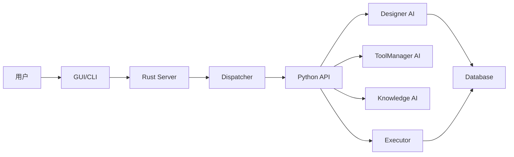

# EAS 2.0 项目结构总览

```
harness/
├── .env.example                    # 环境变量示例
├── .gitignore                      # Git忽略规则
├── Cargo.toml                      # Rust workspace配置
├── README.md                       # 项目说明
├── NEW_ARCHITECTURE_DESIGN.md      # 架构设计文档
├── pytest.ini                      # Pytest配置
│
├── config/                         # 配置文件
│   ├── models.yaml                # AI模型配置
│   ├── database.yaml              # 数据库配置
│   └── server.yaml                # 服务器配置
│
├── rust/                          # Rust代码
│   ├── common/                    # 通用模块
│   │   ├── Cargo.toml
│   │   └── src/
│   │       ├── lib.rs            # 模块入口
│   │       ├── types.rs          # 数据类型
│   │       ├── error.rs          # 错误类型
│   │       └── traits.rs         # 插件化接口（核心）
│   │
│   ├── dispatcher/                # 调度器
│   │   ├── Cargo.toml
│   │   └── src/
│   │       └── lib.rs            # 格式检查+路由
│   │
│   ├── logger/                    # 日志系统
│   │   ├── Cargo.toml
│   │   └── src/
│   │       └── lib.rs            # 高性能日志
│   │
│   ├── tool_manager/              # 工具实例管理
│   │   ├── Cargo.toml
│   │   └── src/
│   │       └── lib.rs            # 工具复制/删除
│   │
│   ├── db/                        # 数据库层
│   │   ├── Cargo.toml
│   │   └── src/
│   │       └── lib.rs            # SQLite/PostgreSQL
│   │
│   ├── server/                    # HTTP服务器
│   │   ├── Cargo.toml
│   │   └── src/
│   │       └── main.rs           # Axum REST API
│   │
│   └── gui/                       # GUI
│       ├── Cargo.toml
│       └── src/
│           └── main.rs            # egui界面（Phase 4）
│
├── python/                        # Python代码
│   ├── __init__.py
│   ├── requirements.txt           # Python依赖
│   ├── pyproject.toml             # Python项目配置
│   │
│   ├── models/                    # 数据模型
│   │   └── __init__.py           # Pydantic模型
│   │
│   ├── utils/                     # 工具函数
│   │   ├── __init__.py
│   │   └── interfaces.py         # 插件化接口（核心）
│   │
│   ├── llm_client/                # LLM客户端
│   │   └── __init__.py           # 统一LLM接口
│   │
│   ├── designer/                  # Designer AI
│   │   └── __init__.py           # 生成设计书+计划
│   │
│   ├── toolmanager/               # ToolManager AI
│   │   └── __init__.py           # 工具评估
│   │
│   ├── knowledge/                 # Knowledge AI
│   │   └── __init__.py           # 知识助手
│   │
│   ├── executor/                  # Executor
│   │   └── __init__.py           # 执行步骤
│   │
│   └── api/                       # FastAPI服务
│       ├── __init__.py
│       └── main.py                # API入口
│
├── schemas/                       # JSON Schema定义
│   ├── design_document.json       # 设计书Schema
│   ├── execution_plan.json        # 执行计划Schema
│   └── tool_schema.json           # 工具Schema
│
├── tools/                         # 工具库
│   ├── README.md                  # 工具规范
│   └── example_tool.py            # 示例工具
│
├── tests/                         # 测试
│   ├── rust/                      # Rust测试
│   │   └── test_dispatcher.rs
│   ├── python/                    # Python测试
│   │   └── test_designer.py
│   └── integration/               # 集成测试
│       └── test_workflow.py
│
├── docs/                          # 文档
│   ├── API.md                     # API文档
│   ├── DEVELOPMENT.md             # 开发指南
│   └── STATUS.md                  # 项目状态
│
└── scripts/                       # 脚本
    ├── init.sh                    # 初始化脚本（Linux/Mac）
    ├── init.bat                   # 初始化脚本（Windows）
    ├── dev.sh                     # 开发环境启动（Linux/Mac）
    └── dev.bat                    # 开发环境启动（Windows）
```

## 核心设计理念

### 1. 插件化架构

**Rust接口 (`rust/common/src/traits.rs`):**
- `AIService` - AI服务接口
- `Dispatcher` - 调度器接口
- `Executor` - 执行器接口
- `ToolManager` - 工具管理接口
- `Logger` - 日志接口
- `Database` - 数据库接口
- `Plugin` - 插件接口
- `PluginManager` - 插件管理器

**Python接口 (`python/utils/interfaces.py`):**
- `AIService` - AI服务基类
- `Designer` - 设计师接口
- `ToolManagerAI` - 工具管理AI接口
- `KnowledgeAI` - 知识助手接口
- `ExecutorAI` - 执行器接口
- `Plugin` - 插件接口
- `PluginManager` - 插件管理器

### 2. 通信架构

```
┌─────────────────────────────────────────┐
│      Rust层 (8090)                      │
│  - GUI                                  │
│  - Dispatcher                           │
│  - Logger                               │
│  - ToolManager                          │
│  - HTTP Server                          │
└─────────────────────────────────────────┘
              ↕ HTTP REST API
┌─────────────────────────────────────────┐
│      Python层 (9000)                    │
│  - Designer AI                          │
│  - ToolManager AI                       │
│  - Knowledge AI                         │
│  - Executor AI                          │
│  - FastAPI Server                       │
└─────────────────────────────────────────┘
              ↕
┌─────────────────────────────────────────┐
│      共享层                              │
│  - SQLite Database                      │
│  - Tool Library                         │
└─────────────────────────────────────────┘
```

### 3. 数据流



## 快速开始

### 1. 初始化
```bash
# Linux/Mac
chmod +x scripts/init.sh
./scripts/init.sh

# Windows
scripts\init.bat
```

### 2. 配置
编辑 `.env` 文件，添加API密钥

### 3. 启动
```bash
# Linux/Mac
./scripts/dev.sh

# Windows
scripts\dev.bat
```

### 4. 访问
- Python API: http://localhost:9000
- Rust Server: http://localhost:8090

## 扩展点

### 添加新的AI服务
1. 实现Python接口（`utils/interfaces.py`）
2. 注册到FastAPI（`api/main.py`）
3. 添加API端点

### 添加新的工具
1. 创建工具文件（`tools/`）
2. 提供工具Schema
3. 通过ToolManager注册

### 创建插件
1. 实现Plugin接口
2. 实现钩子方法
3. 通过PluginManager加载

---

所有组件都通过接口通信，支持灵活替换和扩展。
